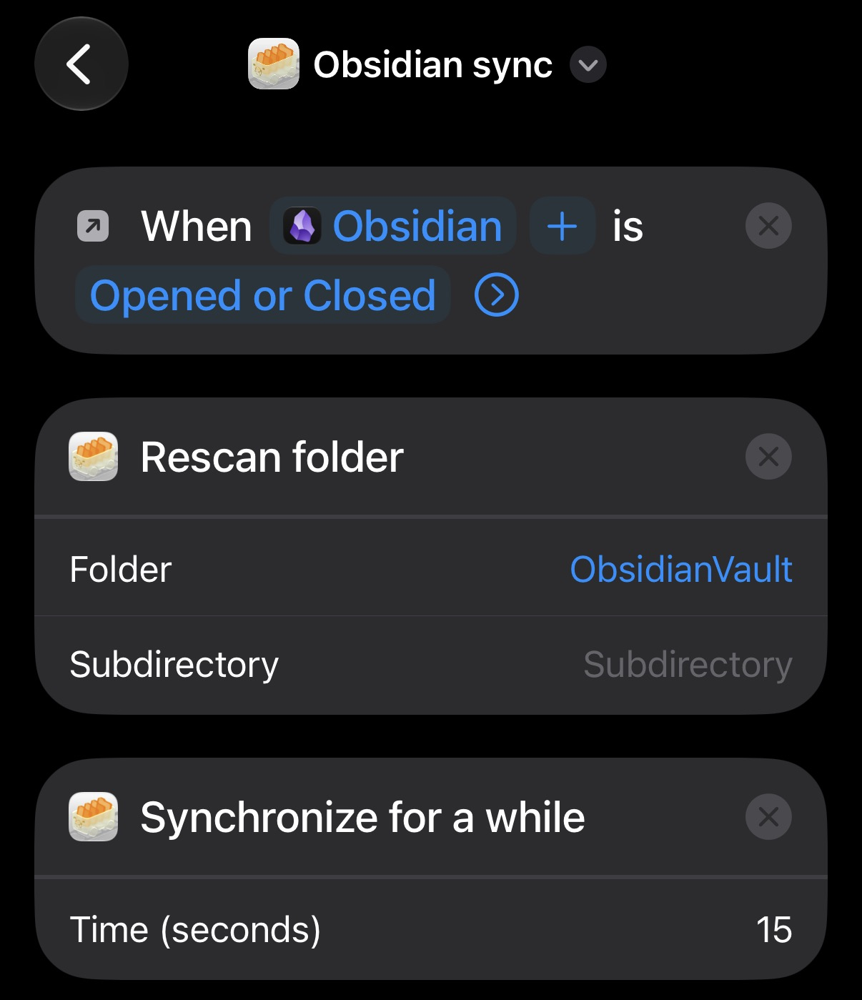

# Free Obsidian sync between iPhone and Linux (Syncthing + Synctrain)

This is a free way to sync Obsidian between an iPhone and a Linux machine, using Syncthing on Linux and Synctrain on iOS. It needs no paid service, cloud account or server.
It should also work on Windows with minimal changes.


The guide also covers:

- [Importing your Apple Notes (iCloud) into Obsidian](#part-2-import-apple-notes-into-obsidian) with a Shortcut
- [Adding to a note with Siri](#part-3-add-to-a-note-with-siri), hands-free

> **Credit:** The Synctrain + Shortcuts approach comes from u/Nearby-Salamander939 in the Reddit post
> [A reliable (and free) way to sync Windows and iOS](https://www.reddit.com/r/ObsidianMD/comments/1p8qp1l/a_reliable_and_free_way_to_sync_windows_and_ios/).
> Their post was written for Windows. This guide adapts it to Linux and adds fixes for problems I ran into.

## How it works, and the trade-offs

Syncthing syncs folders directly between your devices (peer-to-peer), with no server in between. Synctrain is a free iOS app that runs a full Syncthing node on the iPhone.

iOS doesn't let apps sync in the background reliably, so an iOS Shortcuts automation tells Synctrain to sync every time you open or close Obsidian. You could trigger it whenever you open your phone instead, but I haven't found that necessary.

Limitations:

| Limitation | Details |
|---|---|
| Both devices must be online at the same time | It's peer-to-peer. If the laptop is asleep, changes from the phone wait until both are awake. |
| Conflicts are not merged | If the same note is edited on both devices before they sync, Syncthing keeps both versions (`note.sync-conflict-<date>.md`) and you merge them by hand. This is rare if you let a device sync before you start editing on it. |
| It's not a backup | Deletions sync too. Keep a separate backup, and consider turning on File Versioning (see below). |

## Part 1: Sync setup

### 1.1 Back up your vault

Copy your vault folder somewhere safe first.

### 1.2 Install Syncthing on Linux

```bash
# Fedora
sudo dnf install syncthing
# Debian/Ubuntu
sudo apt install syncthing

# Run it as a user service so it starts with your login
systemctl --user enable --now syncthing
```

`--user` runs Syncthing as you, not as root, so it has access to your vault.

### 1.3 Open the firewall

```bash
# firewalld (Fedora and others)
sudo firewall-cmd --permanent --add-service=syncthing
sudo firewall-cmd --reload

# ufw (Ubuntu and others)
sudo ufw allow syncthing
```

This opens port 22000 (sync) and 21027 (local discovery). Without it, the devices can still connect through Syncthing's relays, just more slowly.

### 1.4 Open the Syncthing web UI

Go to `http://127.0.0.1:8384`.

- **Actions → Settings → GUI:** set a username and password.
- **Actions → Show ID:** this is your computer's device ID. You'll need it in a moment.

### 1.5 Create an empty vault on the iPhone

1. Install Obsidian from the App Store.
2. Choose **Create new vault**, with the same name as your vault on Linux.
3. Make sure **Store in iCloud** is off, so the vault is stored on the device.
4. Close Obsidian without changing anything.

Obsidian on iOS can only open vaults in its own folder (**On My iPhone → Obsidian**). If Synctrain stores the files in its own app folder, Obsidian can't see them.

### 1.6 Set up Synctrain

1. Install Synctrain from the App Store and open it once.
2. Add a device: enter your computer's device ID. Accept the connection request in the Syncthing web UI on Linux.
3. Add a folder:
   - Give it a folder ID you'll remember, such as `ObsidianVault`. You'll use it in the shortcut.
   - Set **Folder Type** to **Existing folder...** and choose **On My iPhone → Obsidian → *your vault***.
   - Set it to sync all files. Synctrain defaults to "Selected files" mode, which only downloads files you pick by hand, so Obsidian would see only part of your vault.
   - Share the folder with your computer.

### 1.7 Accept the folder on Linux

1. The web UI will ask whether to add the shared folder. Accept it.
2. Set **Folder Path** to your existing vault folder, such as `~/Documents/MyVault`. Double-check the path. If it points at an empty folder, you'll end up syncing nothing.
3. In the **Sharing** tab, make sure the encryption password field next to the iPhone is empty. If there's a password there, the folder is shared as "untrusted/encrypted" and sync fails (see [Troubleshooting](#troubleshooting)).
4. Save, and wait until both devices show the folder as **Up to Date**.

### 1.8 Create the iOS automation

1. Open **Shortcuts → Automation** and tap **New Automation** (or **+**).
2. Choose **App → Choose → Obsidian**.
3. Check both **Is Opened** and **Is Closed**, and select **Run Immediately**.
4. Turn **Notify When Run** off.
5. Tap **Next → New Blank Automation**, and add these Synctrain actions:
   1. **Rescan Folder:** pick your folder from the list (for example `ObsidianVault`).
   2. **Synchronize for a while:** change `10` to `15`. According to the original poster, values above 15 make the action fail, probably because of iOS's limit on background time.



If Synctrain's actions don't show up in the search, open Synctrain once and try again.

> **Alternative:** the original poster also shared a shortcut that keeps Synctrain running in the background while you use Obsidian, which they found more reliable:
> https://www.icloud.com/shortcuts/a24701c1274e4140b1bd0c8e4a559fd8
> In step 5, pick that shortcut instead of creating a blank automation. As with any shortcut from someone else, read through its actions before you run it.

### 1.9 Test it

1. With the computer awake, edit a note on the iPhone and close Obsidian. Wait about 15 seconds before locking the phone.
2. Check that the change shows up on Linux.
3. Edit a note on Linux, open Obsidian on the iPhone, and check that the change shows up there.

### 1.10 Recommended: turn on File Versioning

In the Syncthing web UI on Linux, go to the folder, then **Edit → File Versioning**, and choose **Trash Can** or **Simple**. Files deleted or overwritten by a change from the iPhone are then kept for a while instead of disappearing for good.

### Habits for reliable sync

- Use only one sync method per vault. Don't combine this with iCloud, Obsidian Sync, LiveSync, Obsidian Git or similar.
- Give the phone a few seconds after you close Obsidian before you lock it.
- Let a device sync before you start editing on it.

## Part 2 (Optional): Import Apple Notes into Obsidian

Obsidian's official Importer plugin can import Apple Notes, but as far as I know only on macOS. However without a Mac, you can use a Shortcut on the iPhone to save every note as a Markdown file directly in your vault.

> This is a one-time copy. Changes you make in Apple Notes afterwards are not carried over, so the cleanest approach is to import once and write new notes in Obsidian from then on. 

### The finished shortcut

```
Find Notes                                  (Limit: 3 while testing)
Repeat with Each item in Notes
    Get Details of Notes  → Name  from  Repeat Item
    Make Markdown from  Repeat Item · Body
    Text:  [Name].md
    Set Name of  Markdown from Rich Text  to  [Text]
    Save File  Renamed Item  → your vault
End Repeat
```


### Step by step

Create a new shortcut in Shortcuts (a normal shortcut, not an automation).

1. **Find Notes**
   - Turn **Limit** on and set it to 3 while you test.
2. **Repeat with Each**, with the notes as input.
3. Inside the loop, add **Get Details of Notes**
   - Detail: **Name**, from **Repeat Item**.
4. **Make Markdown from Rich Text**
   - Tap the **Repeat Item** bubble and choose the property **Body**.
   - If you skip this, the files will contain only the note's title and none of its content.
5. **Text**
   - Insert the **Name** variable and type `.md` right after it.
   - You need this step because the name field in "Set Name" doesn't accept a variable and typed text together.
6. **Set Name**
   - First field: **Markdown from Rich Text**.
   - Second field: **Text**.
   - Shortcuts sometimes changes the first field to the newest action's output when you insert an action above it. Check that it still says *Markdown from Rich Text*. If it says *Text*, the file will contain only its own filename.
7. **Save File**
   - Input: **Renamed Item**.
   - Turn **Ask Where to Save** off. The field for choosing a fixed folder only appears once it is off.
   - Choose **On My iPhone → Obsidian → *your vault***. A subfolder such as `Apple Notes` keeps the import separate.
   - Turn **Overwrite If File Exists** on.

### Run it

1. Run the shortcut with Limit set to 3 and check the files in **Files → On My iPhone → Obsidian → *your vault***.
2. If the names and content look right, turn **Limit** off and run it again.
3. Open Obsidian. The sync automation sends everything to your computer.

### Limitations

- Images and attachments are not included. Only text is.
- Checklists usually become ordinary bullets instead of `- [ ]` tasks.
- Locked notes are skipped. Unlock them first if they should be included.
- The first line of each file is usually the title, because Apple Notes uses the first line as its title.
- If the files end up as `.md.txt`, turn on **Don't Include File Extension** in "Set Name".

## Part 3 (Optional): Automation for appending a note with Siri

Say "Hey Siri, Obsidian dev", then "write unit tests", and `- [ ] write unit tests` is added at the bottom of `dev.md`. It works hands-free, such as when you get an idea while driving.

### The shortcut

1. **Dictate Text**
2. **Text:** type `- [ ] ` and then insert the **Dictated Text** variable. That turns it into an Obsidian task with a checkbox. If you just want text, remove `- [ ]`.
3. **Append to Text File**
   - Folder: choose the vault folder itself. The picker selects folders, so the files appear greyed out. That's normal. Open the vault folder and tap **Open**.
   - File Path: type `dev.md`, or something like `Projects/dev.md` if the note is in a subfolder. It has to be exact and is case-sensitive. Misspelling creates a new file.
   - Turn **Make New Line** on.
4. (Optional) Add Synctrain's **Rescan Folder** and **Synchronize for a while** so the change is sent right away.


### Naming the shortcut

Don't use the word "note" in the name. Siri treats it as a command for Apple's Notes app and creates a normal note instead of running your shortcut. Avoid "reminder" and "message" too. Names that work:

- `Obsidian dev`
- `Dev task`
- `Log to dev`

Without Siri: on iPhones with an Action button (15 Pro and later), you can assign the shortcut under **Settings → Action Button → Shortcut**. Then you hold the button and speak.

For several notes, add a **Choose from Menu** action with options such as `dev`, `school` and `shopping`, or make one shortcut per note.

## Troubleshooting

**"Failed to verify encryption consistency ... remote expects to exchange plain data, but local data is encrypted"**
The folder is shared with an encryption password, which is Syncthing's mode for untrusted devices. You'll see a 🔒 lock icon next to the folder under the iPhone in the web UI. On Linux, go to **Folder → Edit → Sharing**, clear the password field next to the iPhone, and save. If the error comes back, check that the folder in Synctrain is a normal send & receive folder and not "receive encrypted".

**The automation shows a popup asking for a folder**
The folder in **Rescan Folder** points to a folder that no longer exists, for example because you removed and re-added it in Synctrain. Edit the automation and pick the folder from the list again.

**The iPhone shows as "Disconnected" in the web UI**
That's normal when Synctrain isn't open, because iOS suspends it. The devices only connect while Synctrain is active, which is what the automation is for.

**Obsidian on the iPhone can't see the files**
The Synctrain folder is probably stored in Synctrain's own app folder. Remove the folder in Synctrain (this doesn't delete anything on the other device) and add it again with the same folder ID, as an **Existing folder** pointing to **On My iPhone → Obsidian → *your vault***. Then update the folder in the automation.

**Only some notes appear on the iPhone**
Synctrain is in "Selected files" mode. Set the folder to sync all files.

**Files named `.sync-conflict-...`**
The same file was changed on both devices before they synced. Compare the two versions, keep the one you want, and delete the other. Conflicts in `.obsidian/` right after setup usually come from Obsidian's default config files on the new vault. You can delete the conflict copies.
